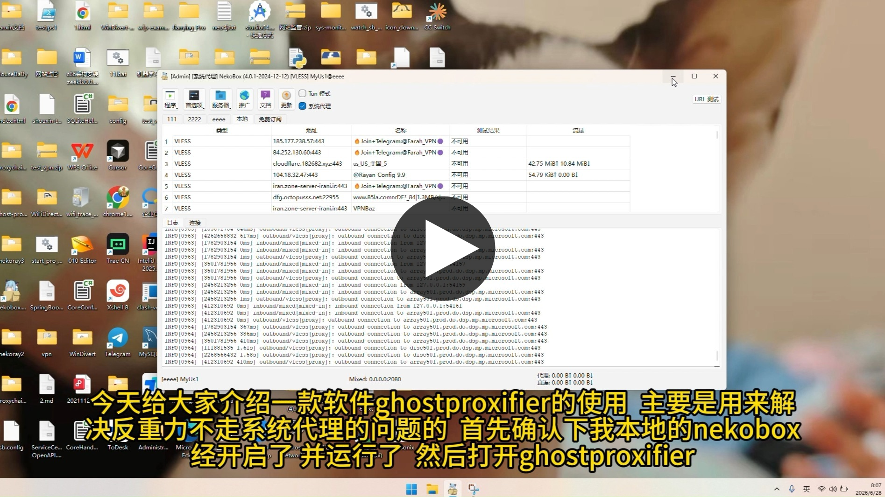
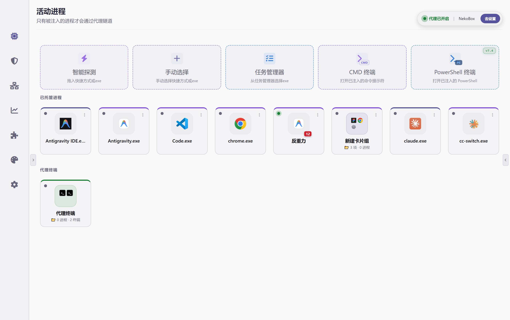
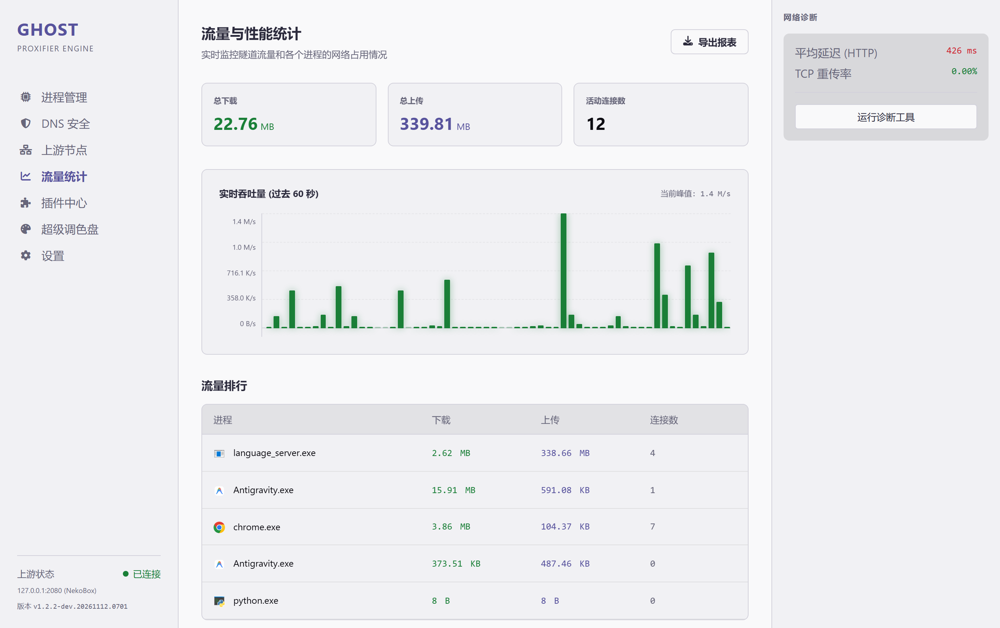
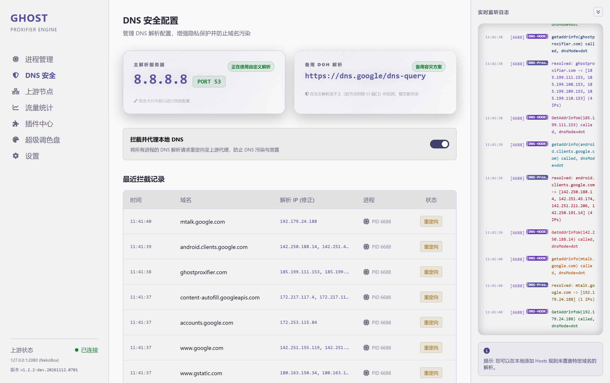
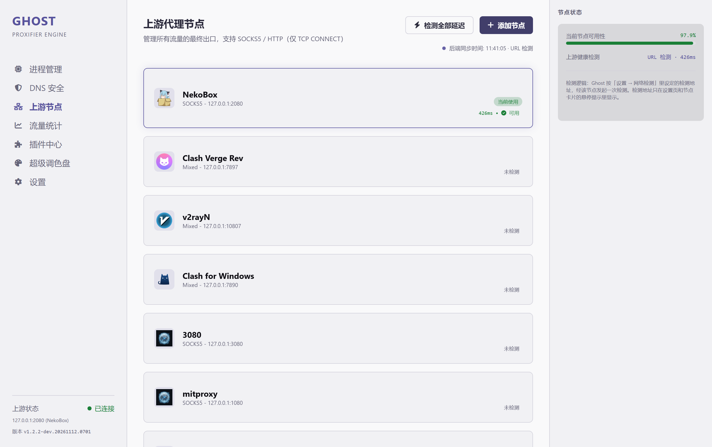

<!-- LOGO & CONTACT -->
<p align="right">
  <a href="https://qun.qq.com/universal-share/share?ac=1&authKey=jLD98s%2BuMM87y8zEcP6tBhrYEyCh2H9gnwigYoYoNLIjY4XqRWTFT0cmx0QDF4hT&busi_data=eyJncm91cENvZGUiOiI5NDUxMzg0MDgiLCJ0b2tlbiI6Imh0cHlaWUViTURaNXoyNklyMGI1akVIcFI5Q3ZIVEFzYktZTEQyRkUwallRck1tQ0d4SFN1d3haNmVMR0lzL3kiLCJ1aW4iOiIxODcxODE0NzQ5In0%3D&data=iw28-MBoXAQ6Pc8ThvaD6YOIC2xcOqodEkkc4rW6JgVNZWNxS5Ka8rqbOiJFZov5cN1L6atFKQwdpoHkdb34fw&svctype=4&tempid=h5_group_info" target="_blank">QQ群</a>
  &nbsp;·&nbsp;
  <a href="https://t.me/ghostproxifier" target="_blank">TG频道</a>
  &nbsp;·&nbsp;
  <a href="https://t.me/+SCVIJJFocWAxN2Y9" target="_blank">TG群组</a>
</p>

<p align="center"></p>

<h1 align="center">Ghost Proxifier Pro</h1>

<p align="center">
  <a href="README-EN.md">🇬🇧 English</a>
  &nbsp;·&nbsp;
  <a href="https://github.com/liliBestCoder/ghost-proxifier-pro/releases" target="_blank">下载</a>
  &nbsp;·&nbsp;
  <a href="https://ghostproxifier.com" target="_blank">官网</a>
</p>

<p align="center">
  <a href="#插件机制"><b>插件机制</b></a>
  &nbsp;·&nbsp;
  <a href="#核心特性">核心特性</a>
  &nbsp;·&nbsp;
  <a href="#已支持应用">支持应用</a>
  &nbsp;·&nbsp;
  <a href="#快速使用">快速使用</a>
  &nbsp;·&nbsp;
  <a href="#架构概览">架构</a>
  &nbsp;·&nbsp;
  <a href="#适用场景">适用场景</a>
  &nbsp;·&nbsp;
  <a href="#与同类工具对比">工具对比</a>
  &nbsp;·&nbsp;
  <a href="#运行截图">截图</a>
  &nbsp;·&nbsp;
  <a href="#faq">FAQ</a>
</p>

<p align="center">
  Windows 原生进程级透明代理工具：完整支持 TCP 与 UDP 双协议转发。无需安装虚拟网卡或驱动，不修改系统路由表；拖入程序即可自动接管目标进程及其子进程的全部网络流量，转发至 HTTP / SOCKS5 代理。
</p>

<p align="center">
  🔧 <a href="https://github.com/liliBestCoder/ghost-proxifier" target="_blank"><b>Ghost Proxifier 开源版</b></a> — 纯命令行工具，MIT 开源
</p>

<p align="center">
  <b>🎬 使用视频：Ghost Proxifier 基础使用演示</b>
</p>

<p align="center">
  <a href="https://www.bilibili.com/video/BV1TkTP61Eyb/" target="_blank">
    
  </a>
</p>

### ⚠️ 使用注意
<blockquote>
<p><font color="#d93025"><b>关于 Windows 安全提示：</b></font><br>目前项目尚未购买微软代码签名证书，因此使用 Microsoft Edge 下载安装包时，部分杀毒软件可能会误报，Windows SmartScreen 也可能弹出拦截提示。</p>
<p>如果 Edge 阻止下载，可在 Edge 中进入：<code>设置 → 隐私、搜索和服务 → 安全性</code>，暂时关闭“防止有害网站和下载”，完成安装包下载后建议立即恢复该设置。</p>
<p>如果运行安装包时仍被 SmartScreen 拦截，在蓝色提示窗口中点击：<code>更多信息 → 仍要运行</code>。</p>
<p>请仅在确认安装包来自本项目官方 Releases 页面，并核对文件来源后再进行上述操作。</p>
<p><font color="#d93025"><b>注入前请确保目标程序及其子进程已经完全退出。</b></font><br>若程序已经在后台运行，注入可能不会生效。请先完全退出程序，再将快捷方式或 <code>.exe</code> 文件拖入窗口。</p>
</blockquote>

## 插件机制

[开发者指南](https://ghostproxifier.com/docs-plugin-sdk.html) · [插件 SDK](https://github.com/liliBestCoder/ghost-plugin-sdk) · [插件商店](https://store.ghostproxifier.com/v1/)

同样是进程级代理，开发者可能想看一次 API 调用经过了哪个出口，运维团队可能想把网络异常做成通知，AI Agent 则可能需要一份可查询的请求记录。这些需求各有自己的界面和工作流，也都可以用到 Ghost 已有的进程路由能力。

我们开放插件机制，是想让熟悉这些场景的开发者一起丰富 Ghost 的软件生态。你可以用宿主提供的目标进程管理、上游节点、统计和事件 API，把一个自用脚本或团队工具做成插件。插件可以在本地迭代，审核上架后，其他用户可以在客户端内发现和安装它。

#### 看看已经有人做了什么

- **端口转发** 把本机端口映射到远端服务，支持 TCP 和 UDP，可直连或经 Ghost 的上游节点。 [查看项目](https://github.com/xieyos/ghost-plugin-port-forwarder)
- **茄盒（Snagbox）** 采集应用流量并保存结构化记录，再通过 MCP 交给 AI Agent 查询和分析。 [查看项目](https://github.com/liliBestCoder/snagbox)
- **事件查看器** 订阅 Ghost 的控制事件，并在自己的页面里展示。它也是一个适合上手的 Python 示例。 [查看源码](https://github.com/liliBestCoder/ghost-plugin-events-viewer)

你的第一个插件可以很小。例如，用一个面板展示某个开发项目的代理配置和进程状态，或者在目标进程启动后发送一条通知。

#### 插件如何运行

- **独立进程**。插件由 Ghost 的插件宿主管理，使用 `manifest.json` 声明入口、运行时和权限。可以从 Python 或 Node.js 起步，也可以提供 Windows 原生可执行文件。
- **按权限调用宿主 API**。外部插件使用自己的临时凭据调用本地 API。目标进程和节点的管理按属主隔离，启动受管进程等敏感操作需要用户确认。
- **可选的嵌入界面**。插件可以提供本地 Web 页面，在 Ghost 的插件面板中展示统计、日志或配置表单。

#### 开始开发

1. 从示例开始。想做事件订阅和界面，可以参考 [事件查看器](https://github.com/liliBestCoder/ghost-plugin-events-viewer)。想了解更多 API 调用，可以参考 [插件能力示例](https://github.com/liliBestCoder/ghost-plugin-showcase)。
2. 在 `manifest.json` 里设置自己的插件 ID、入口和所需权限。把 SDK 克隆到插件项目旁边，在插件项目根目录运行下面的 PowerShell 命令，生成 `.gpkg`。

   ```powershell
   python ../ghost-plugin-sdk/tools/plugin/gpkg.py pack --src . --out ../dist --min-app-version 1.2.2
   ```

   使用 `ghost.target.v1` 等 v1 权限组时，客户端最低版本为 1.2.2。其他权限的最低版本要求可在 SDK 中查询。
3. 在 Ghost 的**设置 → 插件设置**开启**插件开发者模式**，然后在**已安装插件**中选择**从本地安装**，导入生成的 `.gpkg`。启用后验证权限请求、界面和退出行为。

打包工具、签名工具和协议规范都在 [Ghost Proxifier Plugin SDK](https://github.com/liliBestCoder/ghost-plugin-sdk)。

#### 发布到插件商店

本地调试完成后，准备好 `.gpkg`、源码仓库和对应的提交 SHA，以及插件介绍、图标和权限说明。通过官方开发者群联系维护者申请审核。审核和签名完成后，插件可在客户端的插件商店上架。

如果你还在构思，欢迎先带着使用场景来聊。你可以告诉我们想做什么、希望调用哪些能力，或者在接入时卡在了哪一步。 [加入官方开发者 QQ 群 945138408](https://qun.qq.com/universal-share/share?ac=1&authKey=jLD98s%2BuMM87y8zEcP6tBhrYEyCh2H9gnwigYoYoNLIjY4XqRWTFT0cmx0QDF4hT&busi_data=eyJncm91cENvZGUiOiI5NDUxMzg0MDgiLCJ0b2tlbiI6Imh0cHlaWUViTURaNXoyNklyMGI1akVIcFI5Q3ZIVEFzYktZTEQyRkUwallRck1tQ0d4SFN1d3haNmVMR0lzL3kiLCJ1aW4iOiIxODcxODE0NzQ5In0%3D&data=iw28-MBoXAQ6Pc8ThvaD6YOIC2xcOqodEkkc4rW6JgVNZWNxS5Ka8rqbOiJFZov5cN1L6atFKQwdpoHkdb34fw&svctype=4&tempid=h5_group_info)

## 适用场景

- AI 编程，例如 Codex、Claude Desktop、Claude Code、Antigravity、Cursor 等等。
- 多个 VPN/代理软件混用时，只代理指定应用，减少虚拟网卡和路由规则之间的冲突。
- 为不遵循系统代理的命令行工具、开发工具和游戏客户端配置独立代理。
- 为不同应用或账号分配不同代理节点，实现网络 IP 层面的隔离。

## 核心特性

- **TCP & UDP 双协议完整支持**：全量接管目标进程网络流量。无论是 HTTP/HTTPS 等 TCP 连接，还是游戏、语音、DNS 等 UDP 数据包，均可通过 SOCKS5 / HTTP 代理透明转发。
- **免装虚拟网卡，零内核驱动**：无需安装 TUN/TAP 虚拟网卡，不走 WFP 内核驱动，不修改系统全局路由表。极度轻量，单进程精准接管，不污染其他网络，杜绝系统蓝屏或断网风险。
- **拖拽即用，子进程自动追踪**：将快捷方式或 `.exe` 文件拖入窗口秒级生效。全自动递归接管目标程序创建的所有子进程（如浏览器多进程架构），无需手动获取或配置 PID。
- **严格防泄露机制（DNS / DoH / QUIC）**：DNS 查询自动由代理端远端解析，支持 DNS 严格防泄露模式；内置 DoH 阻断机制，并自动拦截 QUIC 降级为 TCP，杜绝浏览器通过 UDP 绕过代理。
- **WinStore 应用原生支持**：完美代理 ChatGPT、Claude 等 Windows 商店应用；WinStore 应用自动更新后能自动感知适应，无需重新配置路径。
- **代理协议与认证支持**：全面兼容 HTTP / SOCKS5 代理协议，支持配置用户名与密码认证，满足各种网络代理环境。
- **实时流量监控与稳定守护**：直观展示各个进程的实时上下行速率与连接统计，内置后台守护机制保障长连接稳定运行。
- **个性化设置与多语言**：支持自定义关闭窗口行为（如最小化至系统托盘后台运行）；界面原生支持简体中文与英文一键切换。
- **一键排障诊断包**：设置页面提供一键导出脱敏排障包功能，方便快速提交反馈与定位问题。

## 已支持应用

<table width="100%" style="table-layout: fixed;">
  <tr>
    <td align="center" width="10%"><br><sub>Chrome</sub></td>
    <td align="center" width="10%"><br><sub>MS Edge</sub></td>
    <td align="center" width="10%"><br><sub>Firefox</sub></td>
    <td align="center" width="10%"><br><sub>Claude Desktop</sub></td>
    <td align="center" width="10%"><br><sub>Claude Code</sub></td>
    <td align="center" width="10%"><br><sub>Codex</sub></td>
    <td align="center" width="10%"><br><sub>Antigravity</sub></td>
    <td align="center" width="10%"><br><sub>Node.js</sub></td>
    <td align="center" width="10%"><br><sub>Python</sub></td>
    <td align="center" width="10%"><br><sub>SSH</sub></td>
  </tr>
  <tr>
    <td align="center"><br><sub>FinalShell</sub></td>
    <td align="center"><br><sub>Xshell</sub></td>
    <td align="center"><br><sub>MySQL Workbench</sub></td>
    <td align="center"><br><sub>BlueStacks X</sub></td>
    <td align="center"><br><sub>CMD</sub></td>
    <td align="center"><br><sub>PowerShell</sub></td>
    <td align="center"><br><sub>CF</sub></td>
    <td align="center"><br><sub>HyperDown</sub></td>
    <td align="center"><br><sub>MSTSC</sub></td>
    <td align="center"><br><sub>Multilogin</sub></td>
  </tr>
</table>

> 理论上支持所有使用 Winsock 的 Windows 应用，以上为已测试和验证过的应用。

## 快速使用

1. 从 [Releases](https://github.com/liliBestCoder/ghost-proxifier-pro/releases) 下载并启动 Ghost Proxifier Pro。
2. 在界面中配置上游 HTTP / SOCKS5 代理和 DNS 设置。
3. 将目标程序的快捷方式或 `.exe` 文件拖入窗口，启动代理进程。

## 架构概览

```text
                           Ghost Proxifier Pro 架构
┌─────────────────────────────────────────────────────────────────────────────┐
│                         目标进程 (e.g. Chrome / ChatGPT)                    │
│                                                                             │
│  ┌──────────┐   ┌──────────┐   ┌──────────┐   ┌─────────────────────────┐  │
│  │ DNS 查询  │   │ TCP 连接  │   │ UDP 发送  │   │ 8.8.8.8:53              │  │
│  │          │   │          │   │          │   │                         │  │
│  │ getaddrinfo│   │ connect()│   │ sendto() │   │ sendto(53)              │  │
│  │GetAddrInfoW│   │ConnectEx()│  │WSASendTo()│  │WSASendTo()              │  │
│  └────┬─────┘   └────┬─────┘   └────┬─────┘   └────┬────────────────────┘  │
│       │              │              │              │                       │
│       └──────┬───────┘              │              │                       │
│              │                      │              │                       │
│         ┌────┴─────────────┐   ┌────┴─────────────┐ ┌────┴─────────────┐   │
│         │ 共享内存 DNS 缓存│   │ 重定向到代理通道 │ │ UDP ASSOCIATE   │   │
│         │ IOCP 线程池      │   │ HTTP / SOCKS5    │ │ STUN 连通性探针 │   │
│         │ Strict 模式防泄露│   │ 用户名密码认证   │ │ QUIC 降级阻断   │   │
│         └──────────────────┘   └──────────────────┘ └─────────────────┘   │
│                                                                             │
│                    ghost_core.dll (注入到目标进程)                            │
└─────────────────────────────────────────────────────────────────────────────┘
                   │                       │
                   │   127.0.0.1:2080      │
                   │                       │
            ┌──────┴───────┐      ┌────────┴────────┐
            │ 上游 HTTP /  │      │ Watchdog 守护   │
            │ SOCKS5 代理  │      │ 崩溃Dump/权限回收│
            │ (Clash/v2ray)│      │ 事件日志镜像    │
            └──────────────┘      └─────────────────┘
```

不装 TUN/TAP 虚拟网卡，不走 WFP 内核驱动。Ghost Proxifier 使用基于 MinHook 的用户态 API Hook，拦截 Winsock 函数，只接管用户选中的进程及其子进程。

## 与同类工具对比

| 特性 | Ghost Proxifier Pro | Proxifier | ProxyBridge | Antigravity-Proxy |
| :--- | :---: | :---: | :---: | :---: |
| TCP 协议代理 | ✅ 完整支持 | ✅ 支持 | ✅ 支持 | ⚠️ 部分支持 |
| UDP 协议转发 | ✅ 完整支持 | ✅ 支持 | ⚠️ 依赖系统配置 | ❌ 不支持 |
| 图形界面与拖拽操作 | ✅ | ⚠️ 需配置规则 | ⚠️ 需配置规则 | ❌ |
| 子进程自动追踪 | ✅ | ⚠️ 规则匹配 | ⚠️ 规则匹配 | ❌ |
| 是否需要虚拟网卡/驱动 | ❌ | ⚠️ WFP 驱动 | ⚠️ WinDivert 驱动 | ❌ |
| 适用范围 | ✅ 通用多应用 | ✅ 通用多应用 | ✅ 通用多应用 | ⚠️ 主要面向单一应用 |
| DNS / DoH / QUIC 处理 | ✅ 内置处理 | ⚠️ 需额外配置 | ⚠️ 需额外配置 | ❌ |

## 运行截图









## FAQ

**Ghost Proxifier Pro 收费吗？**

Ghost Proxifier Pro 现已**完全免费开放（FREE & UNLOCKED）**。¥0.00 无需注册或激活，即可无限制使用拖拽注入、无限应用代理、SOCKS5 / UDP 转发、进程树追踪等全部高级功能。

**Pro 版和开源版有什么区别？**

Pro 版提供图形界面、进程规则管理、流量监控、子进程自动追踪、SOCKS5 认证支持、Watchdog 自动重连和 MSI 安装包。开源版是纯命令行工具。

**下载或运行提示“不支持 Win11/Win10”或安装包打不开？**

这通常**不是系统不兼容**，而是由于浏览器或安全软件拦截了未签名 `.msi` 下载，导致本地仅生成了未完成的临时占位文件（因此双击无响应或提示损坏）。

请直接参考顶部的 **【⚠️ 使用注意】** 章节操作：按说明解除浏览器拦截防护后重新下载，并在 SmartScreen 提示中点击 **“更多信息 → 仍要运行”** 即可。确认下载后的安装包大小在 **3 MB ~ 5 MB** 左右即可正常安装，软件原生完美支持 **Windows 10 / Windows 11 (64位)** 系统。

**如果上游节点页面不能新增节点或编辑节点怎么办？**

多半是软件安装目录配置文件损坏或权限异常导致的。解决方法非常简单：重新点击运行下载的 `.msi` 安装文件，在弹出的安装界面中选择 **Repair (修复)**，完成自动修复后重启 Ghost Proxifier Pro 即可恢复正常。

**启动 ChatGPT / Claude WinStore 程序遇到 `create process error 5` 异常？**

出现 `create process error 5` 错误多半是因为 Windows 当前登录账户不在管理员组、缺乏某些底层 API 调用权限导致的。只需右键桌面或开始菜单中的 **Ghost Proxifier Pro 快捷方式**，选择 **“以管理员身份运行”** 重新启动软件即可。

**如何反馈问题？**

您可以在软件的“设置”页面点击 **【导出排障包】** 生成脱敏诊断文件，然后通过 [GitHub Issue](https://github.com/liliBestCoder/ghost-proxifier-pro/issues) 或官方社群发给开发者排查。

## 企业合作与社群

如果您的企业在出海运营、跨境电商、游戏代理、研发办公或合规审计等场景下，需要更强大的集中管理功能（如全局配置下发、访问审计与监控、动态访问阻断、专有驱动与协议定制），欢迎联系我们探讨合作。

- [QQ 交流群 945138408](https://qun.qq.com/universal-share/share?ac=1&authKey=jLD98s%2BuMM87y8zEcP6tBhrYEyCh2H9gnwigYoYoNLIjY4XqRWTFT0cmx0QDF4hT&busi_data=eyJncm91cENvZGUiOiI5NDUxMzg0MDgiLCJ0b2tlbiI6Imh0cHlaWUViTURaNXoyNklyMGI1akVIcFI5Q3ZIVEFzYktZTEQyRkUwallRck1tQ0d4SFN1d3haNmVMR0lzL3kiLCJ1aW4iOiIxODcxODE0NzQ5In0%3D&data=iw28-MBoXAQ6Pc8ThvaD6YOIC2xcOqodEkkc4rW6JgVNZWNxS5Ka8rqbOiJFZov5cN1L6atFKQwdpoHkdb34fw&svctype=4&tempid=h5_group_info)
- [Telegram 频道 @ghostproxifier](https://t.me/ghostproxifier)
- [Telegram 群组](https://t.me/+SCVIJJFocWAxN2Y9)

## 支持项目

如果 Ghost Proxifier 对你有帮助，欢迎通过微信或 PayPal 支持项目。你的支持将用于软件的持续更新、维护和日常运营：

<table><tr>
  <td align="center"></td>
  <td align="center"></td>
</tr></table>
